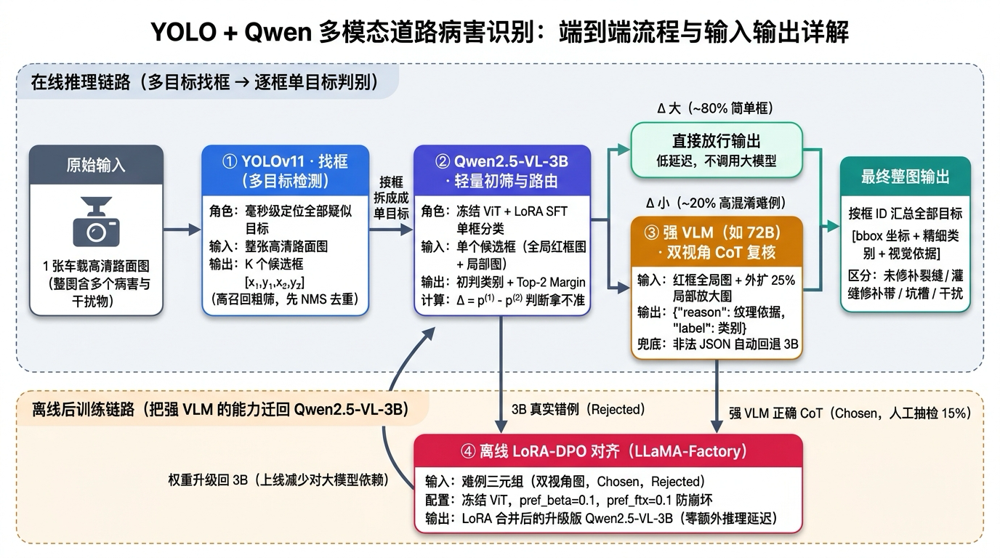
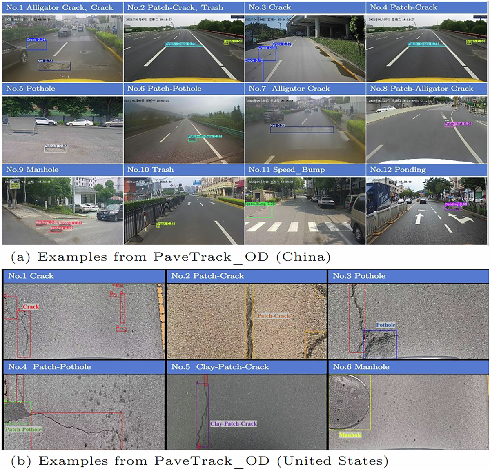

# Road-Defect VLM Post-Training

**城市道路病害多模态细粒度识别与后训练优化**：基于 `PaveTrack` 实车基准的防泄漏数据治理、LoRA SFT、STaR 标签条件 CoT 蒸馏、离线 LoRA-DPO 与 Top-2 Margin 难例路由评测。



---

## 1. 背景与目标

### 1.1 业务痛点
1. **细粒度高度混淆且误报代价不对称**：车载高清移动巡检需严格区分**未修补病害**（`crack`、`pothole`、`alligator_crack`，需派养护工单）与**已修补病害**（`patched_crack`、`patched_pothole`、`patched_alligator_crack`，误报导致重复派单）及非病害干扰（`manhole`、`street_waste`、`speed_bump`、`puddle`）。实车统计显示，`patched_crack` 图像有 **28.7%** 与未修补 `crack` 同框共现。
2. **传统检测器误报严重 & 零样本大 VLM 存在垂域鸿沟**：在 `PaveTrack_OD` 中国子集公开论文基线（*Nature Scientific Data* 2025, Table 2）上，`YOLOv11` Precision 仅 **53.6%**、`mAP@50` **56.9%**；而未微调的 `Qwen2.5-VL-3B`、`InternVL3-8B`、`Qwen3.8-27B` 零样本 Macro-F1 仅 **0.081 / 0.223 / 0.256**。
3. **长尾语义泛化瓶颈**：实测满血 `ResNet18`（13.7 万框 × 12 epoch + 类别反频率加权）在长尾语义类 `speed_bump`（F1 **0.265**，Recall 23.2%）与 `puddle`（F1 **0.307**）上触顶明显。

### 1.2 项目目标与边界
- 固定前级检测框（不做 bbox 坐标回归、不魔改 YOLO 结构），聚焦**框内 10 类细粒度分类纠偏与降误报**。
- 以轻量 **`Qwen2.5-VL-3B`** 为核心（冻结 ViT + 语言侧 LoRA，可训参数 `37.15M / 0.98%`），结合 `Qwen3.8-27B` 离线 STaR 标签条件 CoT 蒸馏、离线 LoRA-DPO（`pref_ftx=0.1`）与 Top-2 Margin 难例路由，在低额外延迟下显著提升边界判别力与长尾表现。

---

## 2. 数据治理与防泄漏切分

使用同济大学交通学院联合斯坦福公开发布的 **[PaveTrack](https://doi.org/10.57760/sciencedb.20383)**（`PaveTrack_OD` 中国子集，**50,000 张图 / 10 类 / 196,579 条框**，平均 3.93 框/图，剔除视角与 class_id 映射均不兼容的美国子集）。



- **标签规范化（`src/repair_labels.py`）**：拆分原始 YOLO 标签中 **5,216 条 `4n+1` 合并行**（49,997 文件解析出 196,568 框，10 类中 8 类与权威逐类框数精确一致）。
- **分层分组防泄漏切分（`src/build_index.py` + `src/prepare_data.py`）**：官方 split 为帧级随机切分（84 条路段中 **76 条 / 90.5% 跨 split**）；改为按 4 种文件名形态提取 **9,591 个分组键**（路段 84 + 长时间戳 768 + 14 位时间戳 471 + 独立图 8,268），类型内贪心按 70/15/15 分配，经 `verify_no_leak()` 验证**组间零泄漏**、构成偏移 `≤ 0.01 pt`（实测落盘：`train` 35,002 图 / `val` 29,349 框 / `test` 28,175 框，均裁剪为外扩 25% 的 `448×448` 局部图）。

---

## 3. 方法链路与实测结果

### 3.1 全量留出测试集主结果（28,175 框 · 10 类 · 零泄漏）

| 阶段 / 方案 | 复核预算 | Macro-F1 | 相对 Stage 1 | Accuracy | 错→对 / 对→错（**净修正**） | 净修正率 / 误改率 | 摊薄额外耗时 |
|---|---|---:|---:|---:|---|---:|---:|
| **Stage 0 零样本 3B** | 0 | **0.0807** | — | 36.05% | — | — | — |
| **零样本 8B / 27B**（双图抽样） | 0 | 0.2231 / 0.2556 | — | 36.5% / 35.0% | — | — | 716 / 600 ms |
| **Stage 1 LoRA SFT** (`Qwen2.5-VL-3B`) | 0 | **0.6466** | 基线（+56.6 pt） | 79.35% | — | — | — |
| **Random 1,500 对照** | 1,500（5.3%） | 0.6480 | +0.13 pt | 79.54% | 116 / 64（+52） | 3.5% / 4.3% | 7.4 ms |
| **Margin 1,500 路由** | 1,500（5.3%） | **0.6681** | **+2.15 pt** | 80.39% | 477 / 186（**+291**） | **19.4%** / 12.4% | **11.0 ms** |
| **Random 20% 对照** | 5,635（20%） | 0.6507 | +0.41 pt | 80.02% | 467 / 280（+187） | 3.3% / 5.0% | 31.7 ms |
| **Margin 20% 路由** | **5,635（20%）** | **0.6805** | **+3.39 pt** | **82.29%** | **1,497 / 669（+828）** | **14.7%** / 11.9% | **34.9 ms** |

- **10 类中 9 类提升**（Stage 1 → Margin 20%）：`puddle` `0.264 → 0.374`（+11.0 pt）、`alligator_crack` `0.635 → 0.720`（+8.5 pt）、`patched_pothole` `0.726 → 0.784`（+5.8 pt）、`pothole` `0.679 → 0.724`（+4.4 pt）、`crack` `0.822 → 0.848`（+2.5 pt）、`patched_crack` `0.824 → 0.844`（+2.0 pt）、`speed_bump` `0.413 → 0.433`（+2.0 pt）、`manhole` `0.930 → 0.945`（+1.6 pt）。

### 3.2 Stage 2 CoT 蒸馏控制变量消融（同 1,200 框验证集，2×2 矩阵）

| 模型（均从 Stage 1 续训同批 2,000 难例） | **Plain 直出（~138 ms）** | **CoT 自由生成（378–1,046 ms）** |
|---|---|---|
| Stage 1（未续训） | `0.6749` / Acc `80.67%` | `0.6667` / Acc `78.83%` |
| Stage 2 无 CoT 对照（`plain`） | `0.6370`（−3.8 pt）/ Acc `81.00%` | `0.6279` / Acc `81.25%` |
| **Stage 2 27B 真 CoT（STaR 标签条件）** | **`0.6770` / Acc `82.50%`** | `0.5517` / Acc `71.25%` |

- **关键发现**：27B 逐图 CoT 在训练期起到密集视觉特征正则化作用（相比同批难例无 CoT 续训 **+4.0 pt**、`puddle` 翻倍）；而 3B 推理期强行自由生成 ~50 token 长 CoT 易受暴露偏差与视觉幻觉拖累，采用**「训练期 CoT 蒸馏 + 推理期 Plain 直出」**兼得最高精度与 7.5× 提速。

### 3.3 与纯 CNN 基线（ResNet18）对比（同 28,175 测试框）

| 模型 | 训练投入 | Macro-F1 | Accuracy | `speed_bump` F1 | `puddle` F1 | 单图耗时 |
|---|---|---:|---:|---:|---:|---:|
| **ResNet18** | 全量 13.7 万框 × 12 ep + 反频率类权重 | 0.7160 | 86.84% | 0.2649 | 0.3068 | 6.61 ms |
| **纯 Qwen-3B 链路** | 2 万框 × 1 ep（无类权重）+ 2k CoT + 1k DPO | 0.6805 | 82.29% | **0.4332**（+16.8 pt） | **0.3735**（+6.7 pt） | Plain 138 ms / 路由 +34.9 ms |
| **ResNet18 + Qwen-3B 融合** | ResNet18 仅路由 5.3%（1,500 框）给 Qwen-3B | **0.7226** | **87.08%** | 0.3105 | 0.3077 | ~27.4 ms（净修正 +68 vs 随机 −153） |

### 3.4 公开检测论文基线参考（*Nature Scientific Data* 2025, Table 2, 中国子集）

> 注：下表为端到端目标检测口径（含定位与背景过滤），与上文给定框 10 类分类口径不同，仅作背景痛点参考。

| 模型 | Precision | Recall | mAP@50 | GFLOPS |
|---|---:|---:|---:|---:|
| Faster-RCNN | 37.2% | 50.1% | 47.2% | 248.5 |
| YOLOv5 | 50.2% | 49.1% | 50.2% | 134.7 |
| YOLOv8 | 52.9% | 50.5% | 54.3% | 165.2 |
| YOLOX | 54.6% | 50.2% | 52.0% | 154.3 |
| **YOLOv11** | **53.6%** | **58.5%** | **56.9%** | **87.2** |
| RT-DETRv2 | 66.8% | 49.8% | 58.3% | 108.2 |

---

## 4. 目录结构与快速运行

```text
road-defect-vlm-posttrain/
├── README.md
├── requirements.txt
├── assets/                          # 架构与标注示意图
├── configs/                         # LLaMA-Factory 多模态配置模板
│   ├── qwen25vl_3b_lora_sft.yaml
│   └── qwen25vl_3b_lora_dpo.yaml
└── src/                             # 数据治理、防泄漏切分与评测脚本
    ├── build_index.py
    ├── repair_labels.py
    ├── prepare_data.py
    ├── evaluate.py
    ├── analyze_split.py
    └── analyze_granularity.py
```

```bash
pip install -r requirements.txt
python3 src/repair_labels.py --src PaveTrack_OD/China/labels --dst labels_norm
python3 src/build_index.py --manifest PaveTrack_OD.json --out index/pt_index_v2.json
python3 src/prepare_data.py --index index/pt_index_v2.json --root PaveTrack_OD --outdir data
python3 src/evaluate.py --pred out/stage1_test.jsonl --route out/route_test.jsonl --refine out/stage2_test.jsonl --out out/metrics_test.json
```

---

## 5. 数据集致谢与引用

> Yang H, Cao J, Wan J, Gao Q, Liu C, Fischer M, Du Y, Li Y, Jain P, Wu D. *A Large-Scale Image Repository for Automated Pavement Distress Analysis and Degradation Trend Prediction.* **Scientific Data**, 2025, 12(1): 1426. DOI: `10.1038/s41597-025-05748-5` · ScienceDB DOI: `10.57760/sciencedb.20383`.
