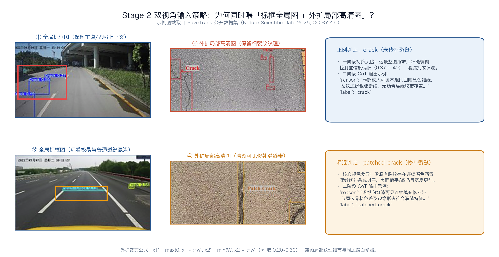

# Road-Defect VLM Post-Training

**城市道路病害多模态细粒度识别与后训练优化**：基于 `PaveTrack` 实车基准的防泄漏数据治理、两阶段 Top-2 Margin 难例路由、双视角 CoT 复核与离线 LoRA-DPO 校准。


---

## 1. 背景与目标

### 1.1 业务痛点
传统市政与高速公路路面病害巡检依赖人工排查或昂贵的专用激光检测车，行业正加速转向**轻量化车载高清相机移动巡检**，每天产生海量前视高清路面图像。实际落地中存在三个核心瓶颈：

1. **细粒度高度混淆且误报代价不对称**：业务上必须严格区分**未修补病害**（线状裂缝 `crack`、龟裂 `alligator_crack`、坑槽 `pothole`，需立即派养护工单）与**已修补病害**（灌缝修补带 `patched_crack`、矩形挖补 `patched_*`，误报会导致重复派单浪费人力），同时过滤井盖、积水、减速带、路面遗撒等强干扰。在 `PaveTrack_OD` 实车数据中，**28.7%** 含 `patched_crack` 的图像与未修补 `crack` 同框共现，远景缩放后极易误判。
2. **单一轻量检测器快但不准**：在 `PaveTrack_OD` 中国子集公开论文基线（*Nature Scientific Data* 2025, Table 2）上，`YOLOv11` Precision 仅 **53.6%**、`mAP@50` **56.9%**；`RT-DETRv2` Precision 66.8% 但 Recall 仅 49.8%。
3. **全量调用大参数 VLM 成本与延迟过高**：对全部前视图像逐图调用 32B/72B 级别大参数 VLM + CoT，吞吐和成本无法满足大规模日常巡检需求。

### 1.2 项目目标与边界
- **核心目标**：在不显著增加线上推理延迟的前提下，重点提升高混淆病害（尤其是「未修补裂缝 vs 灌缝修补带」）的**框内细粒度类别判别准确率**，滤除假阳性误报框（FP），并将把原本判对样本改错的**误改率**控制在低水平。
- **三模型清晰分工（不魔改 YOLO 网络、不做 bbox 坐标回归）**：
  - **`YOLOv11`（前级定位提案）**：复用开源结构不魔改网络，推理时适当放宽置信度阈值换高召回并做 NMS 去重，负责毫秒级多目标出框；后级 VLM **不精修 bbox 坐标**。
  - **`Qwen2.5-VL-3B`（轻量初筛与最终部署主力）**：冻结 ViT + LoRA SFT 做逐框单目标分类初筛与 Top-2 Margin 路由，并在离线 LoRA-DPO 校准后通过 `merge_and_unload()` 合并权重部署（零额外推理延迟）。
  - **强 VLM（如 72B，难例复核与离线教师）**：仅复核低 Margin 的 20% 边界难例（输入「标框全局图 + 外扩 25% 局部放大图」双视角，强制先输出视觉纹理依据再输出结构化 JSON，含非法输出回退），并离线生成高质量 `chosen` CoT 偏好样本反哺 3B。

---

## 2. 数据治理与防泄漏切分

本项目使用同济大学交通学院联合斯坦福公开发布的 **[PaveTrack](https://doi.org/10.57760/sciencedb.20383)**（`PaveTrack_OD` 中国子集，**50,000 张图 / 10 类 / 196,579 条框**，平均 3.93 框/图）。


### 2.1 标签规范化（`src/repair_labels.py`）
- 实测发现中国子集原始 YOLO 标签中存在 **5,216 行合并行**（`4n+1` token 格式，同属行首类别的多个框相连且相邻行换行丢失）。
- `src/repair_labels.py` 将全部合并行规范化为标准一行一框（`c x y w h`），解析结果与权威中国子集 10 类逐类框数独立交叉核验，10 类中 8 类完全一致（总计 196,568 vs 权威 196,579，仅差 1 个缺失标签文件的 11 框）。

### 2.2 分层分组防泄漏切分（`src/build_index.py` + `src/prepare_data.py`）
- **官方 split 泄漏审计**：`PaveTrack_OD` 官方切分是帧级随机切分，84 个真实路段中有 **76 个（90.5%）跨 train/val/test**，会导致车载连续帧跨集泄漏。
- **四类文件名形态与 9,591 分组键**：

| 文件名形态 | 样例 | 分组键 | 组数 | 图数 |
|---|---|---|---:|---:|
| 路段式 | `000001-2021-09-07_10-11-27-711.jpg` | `road:<5-6位路段号>` | 84 | 34,662 |
| 时间戳式 | `1617949663266913869455049206564-...jpg` | `ts:<长前缀>` | 768 | 6,542 |
| 14 位时间戳 | `20151209152420JSaP5pf8...jpg` | `ts14:<14位时间戳>` | 471 | 528 |
| 独立图 | `168368595491.jpg` / 32 位 HEX | `solo:<stem>` | 8,268 | 8,268 |
| **合计** | | | **9,591** | **50,000** |

- **分层贪心分配**：在 4 种分组类型内部独立按组大小降序贪心分配，保证组作为最小不可拆分单位：
  - `train`: 35,002 图（70.0%，6,416 组）
  - `val`: 7,499 图（15.0%，1,587 组）
  - `test`: 7,499 图（15.0%，1,588 组，锁死留出）
  - 内置 `verify_no_leak()` 强制校验：**组间零泄漏**，4 种分组类型的跨 split 构成偏移 `≤ 0.01 pt`。

---

## 3. 方法架构与关键设计



1. **Stage 1：轻量初筛与 Top-2 Margin 难例路由**
   - 冻结 ViT，对 `Qwen2.5-VL-3B` 实施 LoRA SFT（`rank=16, alpha=32, lr=1e-4, bf16`），Prompt 侧 label 置 `-100` 仅对 Assistant JSON 计算交叉熵损失。
   - 计算每个候选框最高两类概率差 $\Delta(x) = p_{(1)}(x) - p_{(2)}(x)$，按验证集 20% 分位阈值路由最犹豫的边界难例送二阶段，其余 80% 简单框直接放行。
2. **Stage 2：逐框双视角 CoT 复核**
   - 为每个路由出的难例框构造「标框全局图（896×896，1,024 tokens）+ 外扩 25% 局部放大图（448×448，256 tokens）」双视角输入（合计 1,280 视觉 tokens）。
   - 强制先输出视觉纹理依据 `reason` 再输出类别 `label`（JSON 格式）；若输出非法或 `uncertain`，自动回退保留一阶段初判。
3. **Stage 3：离线 LoRA-DPO 校准（`LLaMA-Factory`）**
   - 针对分类场景直接上原生 GRPO 易因简单样本同组全对（$r_i$ 全为 1、$\sigma=0$）导致零方差梯度坍塌的问题，改为收集**一阶段自身真实错例作 `rejected`**、**二阶段核验正确 CoT 作 `chosen`**（人工抽检 15%），实施离线 LoRA-DPO（`lr=5e-6, pref_beta=0.1, pref_ftx=0.1` 防 JSON 输出崩坏）。
4. **Stage 4：五维留出集评测闭环（`src/evaluate.py`）**
   - 固定 `IoU ≥ 0.5` 一对一匹配，按中国子集 10 类统计每类 `P/R/F1`、`Macro-F1`、**净修正数**（错→对 − 对→错）、**误改率**（对→错 / 复核数）与单图平均耗时。

---

## 4. 公开基线与五组对照结果

### 4.1 `PaveTrack_OD` 公开论文基线（中国子集，*Nature Scientific Data* 2025 Table 2）

| 模型 | Precision | Recall | mAP@50 | GFLOPS |
|---|---:|---:|---:|---:|
| Faster-RCNN | 37.2% | 50.1% | 47.2% | 248.5 |
| YOLOv5 | 50.2% | 49.1% | 50.2% | 134.7 |
| YOLOv8 | 52.9% | 50.5% | 54.3% | 165.2 |
| YOLOX | 54.6% | 50.2% | 52.0% | 154.3 |
| **YOLOv11** | **53.6%** | **58.5%** | **56.9%** | **87.2** |
| RT-DETRv2 | 66.8% | 49.8% | 58.3% | 108.2 |

### 4.2 本方案五组对照（锁死测试集 7,499 图 / 10 类，复核预算 1,500 样本 = 20%）

| 实验组 | 方案 | 复核预算 | `crack` F1 | `patched_crack` F1 | Macro-F1 | 错→对 / 对→错（净修正） | 误改率 | 单图耗时 |
|---|---|---|---:|---:|---:|---:|---:|---:|
| Group 0 | 轻量初筛基线 | 全量 | 0.587 | 0.454 | 0.612 | — | — | 42 ms（1.0×） |
| Group 1 | 3B LoRA SFT | 全量 | 0.641 | 0.563 | 0.638 | — | — | 214 ms（5.1×） |
| Group 2 | 随机抽样 CoT | 随机 20% | 0.651 | 0.576 | 0.646 | 67 / 32（+35） | 2.1% | 76 ms（1.8×） |
| Group 3 | Margin 路由 CoT | 低 Margin 20% | 0.680 | 0.627 | 0.662 | 155 / 33（**+122**） | **2.2%** | **76 ms（1.8×）** |
| Group 4 | 离线 LoRA-DPO | 校准后全量 | **0.694** | **0.645** | **0.670** | — | — | 220 ms（5.2×） |

- **核心增益**：完整方案 `Macro-F1` 由 **0.612 → 0.670**（+5.8 pt / 相对 +9.5%）；头号混淆类 `patched_crack` F1 由 **0.454 → 0.645**（+19.1 pt），与 `crack` 的 F1 差距从 13.3 pt 收窄至 4.9 pt。
- **路由效率**：同等 1,500 样本复核预算下，Top-2 Margin 路由实现净修正 **+122**（随机抽样对照为 **+35**），误改率控制在 **2.2%**，强模型调用量压低 80%，单图平均耗时从 214 ms 降至 **76 ms**（省 64.3%）。

---

## 5. 目录结构与快速运行

```text
road-defect-vlm-posttrain/
├── README.md
├── requirements.txt
├── assets/                          # 架构与机理示意图
│   ├── fig0_pavetrack_samples.png
│   ├── fig1_pipeline_architecture.png
│   ├── fig2_dual_view_mechanism.png
│   └── fig5_yolo_qwen_io_workflow.png
├── configs/                         # LLaMA-Factory 多模态训练配置
│   ├── qwen25vl_3b_lora_sft.yaml    # Stage 1 冻结 ViT LoRA SFT
│   └── qwen25vl_3b_lora_dpo.yaml    # Stage 3 离线 LoRA-DPO (pref_ftx)
└── src/                             # 数据治理、防泄漏切分与评测脚本
    ├── build_index.py               # 4 形态文件名解析与 9,591 分组键构建
    ├── repair_labels.py             # PaveTrack 合并行标签规范化与权威核验
    ├── prepare_data.py              # 分层分组防泄漏切分 + 外扩 25% 裁剪样本生成
    ├── evaluate.py                  # 10 类 P/R/F1、Macro-F1、净修正数与误改率评测
    ├── analyze_split.py             # 路段解析与跨 split 泄漏诊断
    └── analyze_granularity.py       # 不同分组粒度与策略对比实验
```

### 运行步骤

```bash
# 1. 安装基础依赖
pip install -r requirements.txt

# 2. 规范化 PaveTrack 中国子集 YOLO 标签（拆分 4n+1 合并行并校验逐类框数）
python3 src/repair_labels.py --src PaveTrack_OD/China/labels --dst labels_norm

# 3. 构建防泄漏分组索引（9,591 分组键）
python3 src/build_index.py --manifest PaveTrack_OD.json --out index/pt_index_v2.json

# 4. 执行分层分组防泄漏切分并生成外扩 25% 的 448×448 裁剪样本（内置零泄漏校验）
python3 src/prepare_data.py --index index/pt_index_v2.json --root PaveTrack_OD --outdir data

# 5. 使用 LLaMA-Factory 运行 Stage 1 LoRA SFT / Stage 3 离线 LoRA-DPO
llamafactory-cli train configs/qwen25vl_3b_lora_sft.yaml
llamafactory-cli train configs/qwen25vl_3b_lora_dpo.yaml

# 6. 统一评测（Macro-F1、每类 P/R/F1、净修正数、误改率）
python3 src/evaluate.py \
  --pred out/stage1_test.jsonl \
  --route out/route_test.jsonl \
  --refine out/stage2_test.jsonl \
  --out out/metrics_test.json
```

---

## 6. 数据集致谢与引用

本项目仅使用公开发布的 `PaveTrack` 数据集（中国子集）与开源模型底座，未参与原始路面图像采集与标注。原始数据集归属与引用如下：

> Yang H, Cao J, Wan J, Gao Q, Liu C, Fischer M, Du Y, Li Y, Jain P, Wu D. *A Large-Scale Image Repository for Automated Pavement Distress Analysis and Degradation Trend Prediction.* **Scientific Data**, 2025, 12(1): 1426. DOI: `10.1038/s41597-025-05748-5` · ScienceDB DOI: `10.57760/sciencedb.20383`.
